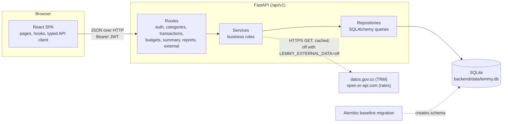
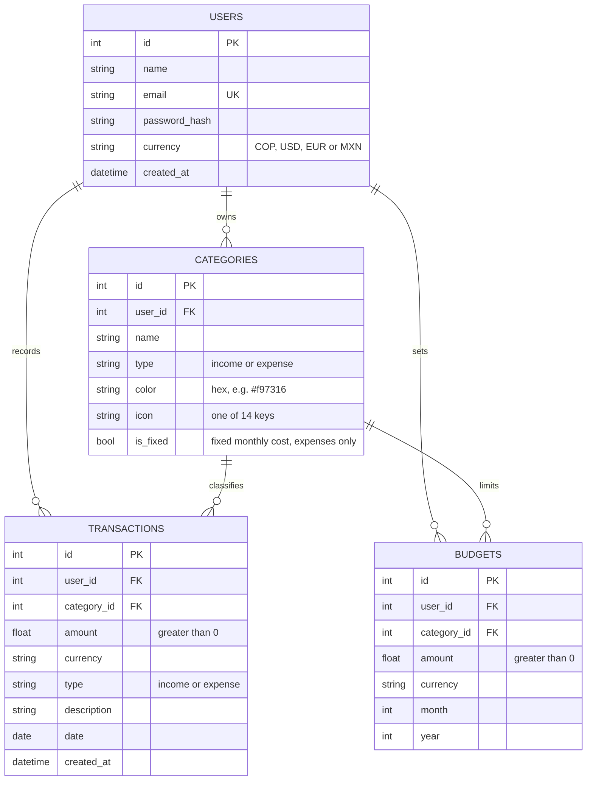
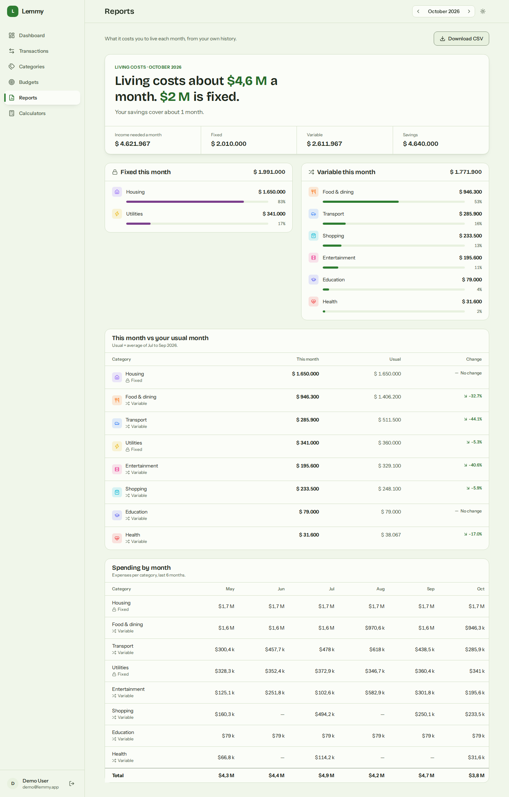
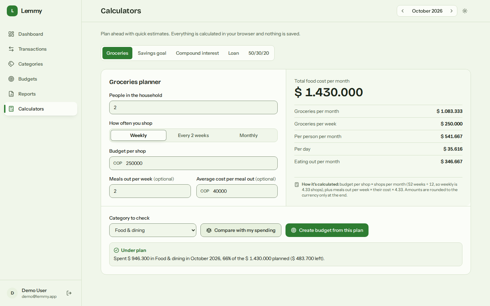
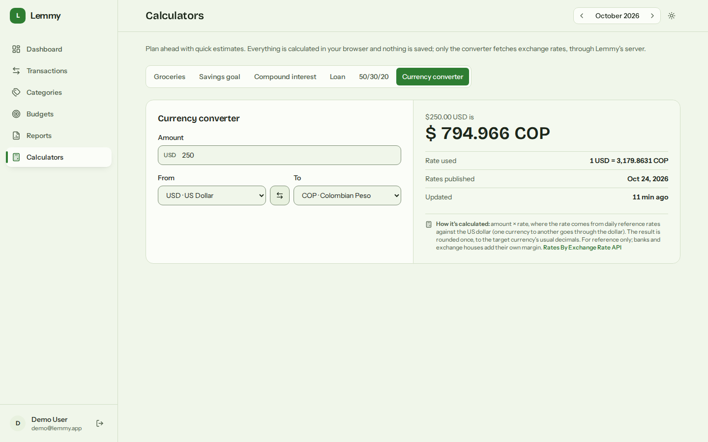
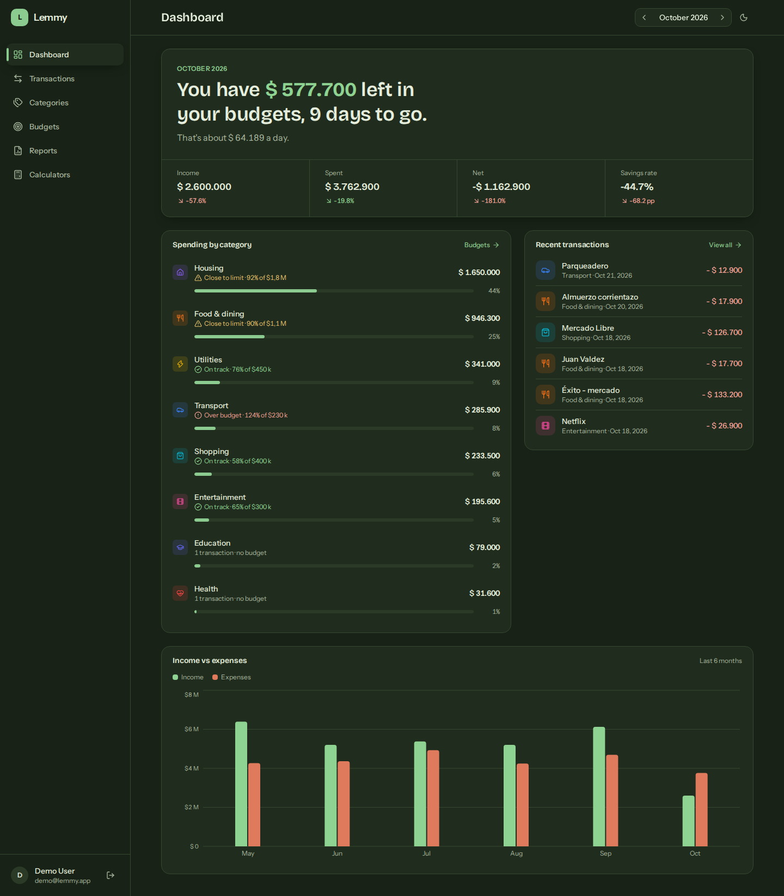

# Lemmy

[](https://github.com/Rerzd/Lemmy/actions/workflows/ci.yml) [](LICENSE)

**A personal finance tracker that tells you where your money went this month, and whether you're still on budget.**

Lemmy records income and expenses by category, sets monthly budgets per category, and turns them into a dashboard: month-over-month KPIs, a six-month income vs expenses trend, spending by category and budget health. It's a full-stack project built to be easy to run: one command starts the API and the web app against a local SQLite file, already seeded with six months of realistic demo data.


## Features

- **Dashboard**: opens with one sentence about the month ("You have $ 589.700 left in your budgets, 11 days to go") and the figures behind it; spending by category as a ranked list with bars and budget status; recent transactions; a six-month income vs expenses chart; and the official dollar rate (TRM) of the day.
- **Transactions**: grouped by day, with the month's money in and out; filter by type, category and description search (debounced), all kept in the URL; server-side pagination; add, edit and delete with the backend's validation messages shown in the form.
- **Categories**: income and expense side by side, each with this month's total, transaction count and a bar; 10 colors and 14 icons; 11 sensible defaults created on sign-up.
- **Reports**: what it costs to live each month, opening with a sentence ("Living costs about $4,6 M a month. $2 M is fixed.") and how long savings would last; fixed and variable costs as two lists; this month vs the usual month per category; spending by month; CSV export of the month's transactions.
- **Calculators**: planning tools with live results and a one-line explanation of the math: a groceries planner (per month, week, person and day, plus eating out) that can compare the plan with a category's real spending and create a budget from it; a savings goal; compound interest with a yearly table; a loan payment with its French amortization schedule; the 50/30/20 rule checked against the real month; and a currency converter. Every rate is an effective annual rate (EA) converted to monthly as (1 + EA)^(1/12) − 1. The math runs in the browser; only the converter fetches exchange rates, through the API. The selected calculator lives in `?tool=`.
- **External data**: the TRM from datos.gov.co and daily exchange rates for 10 currencies, fetched by the backend only, cached in SQLite and served stale (clearly labeled) when a source is down. One switch, `LEMMY_EXTERNAL_DATA=off`, turns every outgoing request off. See [External data](#external-data).
- **Budgets**: monthly limit per expense category with spent, remaining, percent used and a status (on track, close to limit, over budget) shown with an icon and a label, never color alone. In the current month a tick on each bar marks an even pace, so it's clear which budgets are running ahead.
- **Month navigation**: the selected month lives in `?month=YYYY-MM`, so every view can be bookmarked and shared.
- **Light and dark themes**: follows the system by default, remembers a manual choice, and applies it before the first paint. Every text color meets WCAG AA in both themes (checked by a test).
- **Responsive**: sidebar on desktop, bottom navigation on phones (Dashboard, Transactions, Budgets, Reports, plus a "More" menu for Categories and Calculators), and touch targets of at least 44 px on small screens.
- **Demo account**: `demo@lemmy.app` / `demo1234`, one click from the login page.

## Tech stack

| Layer | Tools |
|---|---|
| Backend | Python, FastAPI, SQLAlchemy 2, Alembic, Pydantic 2, JWT (python-jose) with bcrypt password hashing |
| Database | SQLite (single file, foreign keys enforced) |
| Frontend | React 19, TypeScript, Vite, Tailwind CSS 4 with design tokens, React Router 7, Recharts, lucide-react icons, sonner toasts, axios, self-hosted Bricolage Grotesque and Instrument Sans |
| Tests | pytest + httpx (API), Vitest + Testing Library (frontend) |
| Tooling | npm scripts with `concurrently`, ESLint, optional Docker Compose |

## Architecture



The backend is layered so each piece has one job:

- **Routes** parse and validate the request (Pydantic schemas) and pick the current user from the JWT.
- **Services** hold the business rules: type and category must match, a category can't be deleted while it's in use, budgets only on expense categories, and so on.
- **Repositories** are the only code that talks to SQLAlchemy. Summary queries aggregate in SQL (`SUM`, `COUNT`, `GROUP BY` over half-open date ranges) instead of loading rows into Python.

The frontend keeps the same separation: `api/` holds one typed module per resource, `hooks/` holds data fetching and URL state, and `pages/` composes small components from `components/`.

### Data model



Budgets are unique per `(user_id, category_id, month, year)`, and transactions have an index on `(user_id, date)` for the monthly queries.

## Quickstart

You need **Python 3.12+** and **Node.js 22+**.

```bash
git clone https://github.com/Rerzd/Lemmy.git
cd Lemmy

npm run setup    # creates backend/.venv, installs both apps, creates the database and seeds the demo user
npm run dev      # API on http://localhost:8000, web app on http://localhost:5173
```

There's no virtualenv to activate: the npm scripts run Python through `scripts/py.mjs`, which uses `backend/.venv` when it exists and falls back to `python3` / `python` otherwise. Set `LEMMY_PYTHON` to use a specific interpreter.

Open http://localhost:5173 and click **Try the demo account**. Interactive API docs are at http://localhost:8000/docs.

No `.env` is needed: every setting has a working development default. To change one, copy `backend/.env.example` to `backend/.env` (or `frontend/.env.example` to `frontend/.env` for the API URL).

| Setting | Default | What it does |
|---|---|---|
| `DATABASE_URL` | `sqlite:///./data/lemmy.db` | Database, relative to `backend/` |
| `SECRET_KEY` | a dev-only placeholder | Signs the JWTs; set a real one outside your machine |
| `ACCESS_TOKEN_EXPIRE_MINUTES` | `1440` | Session length |
| `CORS_ORIGINS` | `http://localhost:5173` | Comma-separated origins allowed to call the API |
| `LEMMY_EXTERNAL_DATA` | `on` | `off` stops every outgoing request (TRM and exchange rates); the app keeps working and says "External data is off" |
| `VITE_API_URL` (frontend) | `http://localhost:8000/api/v1` | Where the web app finds the API |

The app works offline: with no internet the dollar card and the converter show "unavailable" (or the last cached value), and everything else is local.

| Script | What it does |
|---|---|
| `npm run setup` | Create `backend/.venv` if needed, install root, frontend and backend dependencies, migrate and seed |
| `npm run dev` | Run API and web app together, with reload |
| `npm run db:migrate` | `alembic upgrade head` |
| `npm run db:seed` | Create or reset the demo user and its data |
| `npm run db:reset` | Delete the database file, migrate and seed again |
| `npm test` | Backend tests, then frontend tests |

### With Docker (optional)

```bash
docker compose up --build
docker compose exec backend python -m app.scripts.seed_demo   # optional demo data
```

The app is served on http://localhost:8080 and the API on http://localhost:8000. The backend image runs as a non-root user and applies migrations on start; the database lives in the `lemmy-data` volume. Set `SECRET_KEY` in your shell before running it anywhere but your own machine. `LEMMY_EXTERNAL_DATA=off docker compose up` runs it without any outgoing request.

## API overview

All endpoints are under `/api/v1`. Everything except register and login needs an `Authorization: Bearer <token>` header, and every query is scoped to the current user.

| Method | Path | Description |
|---|---|---|
| POST | `/auth/register` | Create an account (also creates the 11 default categories) |
| POST | `/auth/login` | Form fields `username` (email) and `password`; returns a JWT valid for 24 h |
| GET | `/auth/me` | Current user |
| GET, POST | `/categories` | List or create categories |
| GET, PUT, DELETE | `/categories/{id}` | Read, update or delete a category |
| GET | `/transactions` | Filters: `month`, `year`, `type`, `category_id`, `q`, `date_from`, `date_to`; paging with `limit` (max 500) and `offset`. The total is in the `X-Total-Count` header |
| POST | `/transactions` | Create a transaction |
| GET, PUT, DELETE | `/transactions/{id}` | Read, update or delete a transaction |
| GET, POST | `/budgets` | List budgets (optionally filtered by `month` and `year`) or create one |
| GET | `/budgets/status` | Each budget for a month with spent, remaining, percent used and status |
| GET, PUT, DELETE | `/budgets/{id}` | Read, update the amount of, or delete a budget |
| GET | `/summary/overview` | Income, expenses, net, savings rate and change vs the previous month |
| GET | `/summary/by-category` | Totals and share per category for a month (`type`, default `expense`) |
| GET | `/summary/trend` | Income, expenses and net for the last `months` months (1 to 24, default 6), including empty months |
| GET | `/reports/living-costs` | `month=YYYY-MM`: this month's expenses split into fixed and variable, the usual month (average of up to 3 complete months before it, with `months_used`), income needed to cover it, savings and how many months they cover |
| GET | `/reports/category-spending` | `from` / `to` as `YYYY-MM` (up to 24 months, default the last 6): expenses per category per month, zero-filled |
| GET | `/reports/export.csv` | `month=YYYY-MM`: that month's transactions as CSV (date, description, category, type, amount) |
| GET | `/external/status` | Whether external data is on, the supported currencies, and each source with its last successful fetch |
| GET | `/external/trm` | The TRM for `date=YYYY-MM-DD` (default today in Colombia): value, validity range, source, `fetched_at`, `age_seconds`, `stale` |
| GET | `/external/rates` | `base=USD&symbols=COP,EUR` (codes from the supported list, else `422`): rates, when the source published them, `fetched_at`, `stale` |

`month` and `year` default to the current month on the `/summary/*` endpoints and `/budgets/status`.

The `/external/*` endpoints always answer `200` with a `status`: `ok`, `stale` (the source failed; this is the last good value, with its age), `unavailable` (the source failed and nothing is cached) or `off`. An outage upstream is never a `500`.

## External data

| Source | Used for | Endpoint called | Updates | Terms |
|---|---|---|---|---|
| [TRM, Superintendencia Financiera de Colombia](https://www.datos.gov.co/d/32sa-8pi3) on datos.gov.co (dataset `32sa-8pi3`) | The dashboard's "Dollar today" card | `https://www.datos.gov.co/resource/32sa-8pi3.json` with `$where=vigenciadesde <= 'DAY'`, `$order=vigenciadesde DESC`, `$limit=1`; fields `valor`, `unidad`, `vigenciadesde`, `vigenciahasta` | Every business day; a Friday's TRM is usually valid until Monday, so validity is a date range | Open data, CC BY-SA 4.0. No key; anonymous requests are rate limited by the platform |
| [ExchangeRate-API, open access](https://www.exchangerate-api.com/docs/free) | The currency converter | `https://open.er-api.com/v6/latest/USD` | Once a day | No key. Attribution required (the converter shows "Rates By Exchange Rate API"); caching allowed; the data may not be redistributed; too many requests get a `429` for 20 minutes. [Terms](https://www.exchangerate-api.com/terms) |

The ECB-based APIs (such as Frankfurter) were checked and don't include COP, which is why the rates come from ExchangeRate-API.

How the backend talks to them:

- **Only the backend calls out**, to these two fixed URLs. Nothing a user sends becomes part of a host or path; dates and currency codes are validated first (`422` otherwise, and the supported currencies are COP, USD, EUR, MXN, GBP, CAD, BRL, CLP, PEN and ARS).
- **Every request** is HTTPS GET with a `Lemmy/1.0` User-Agent, refuses redirects, gives up after 4 seconds in total and rejects bodies over 64 KB.
- **Cache** in the `external_cache` table: today's TRM and the rates for 6 hours, past TRM days for 30 days, and a day whose TRM isn't published yet for 1 hour. Concurrent requests for the same value wait for one fetch instead of each calling the source. All currencies come from one cached USD table, so any base costs no extra request.
- **When a source fails** (network, timeout, HTTP error, malformed or oversized answer), the last good value is served flagged `stale` with its age, and the source isn't retried for 60 seconds. Failed answers are never cached. With nothing cached the answer is `unavailable`.
- **The browser** keeps answers for 10 minutes (1 minute when they aren't `ok`), so switching months or pages doesn't ask again. The dashboard never waits for the dollar card.
- **`LEMMY_EXTERNAL_DATA=off`** makes the endpoints answer `off` without touching the network; the HTTP layer refuses to run as a second guard.

## Business rules

The API enforces these, and the frontend shows its messages as they come back:

- **Amounts are positive.** Whether money comes in or goes out is the transaction's `type`, never the sign. Zero or negative amounts are a `422`.
- **Type must match the category.** An expense can't be filed under an income category (`422`).
- **One currency per account.** Transactions and budgets use the account's currency; sending a different one is a `422` ("Multi-currency is not supported yet").
- **Budgets only on expense categories**, and only one per category per month (`409` on a duplicate).
- **No cascading deletes.** A category with transactions or budgets can't be deleted; the `409` says how many it has. Changing the type of a category that has transactions is also a `409`.
- **Budget status:** under 80 % used is *on track*, 80 to 100 % is *close to limit*, over 100 % is *over budget*.
- **Percent changes** compare against the previous month and divide by its absolute value, so a net going from -100 to -50 counts as an improvement. When the previous value is zero the change is `null` rather than infinity.
- **Savings rate** is net divided by income, and `null` in a month without income.
- **Fixed costs:** only expense categories can be marked as a fixed monthly cost (`422` otherwise). New accounts start with Housing and Utilities marked as fixed.
- **Living-costs baseline:** the average of up to 3 complete months before the report month. A month counts once it's over and on or after the user's first transaction, so a new account isn't averaged against empty months; `months_used` says how many were averaged. With no history the baseline, income needed and cushion are `null`, not `0`.
- **Cushion:** all-time income minus all-time expenses (never below 0), divided by the monthly baseline; `null` when the baseline is `0`.
- **CSV export:** fields with commas, quotes or newlines are quoted (RFC 4180); text cells starting with `=`, `+`, `-`, `@`, tab or carriage return get a leading `'` so spreadsheets don't run them as formulas. The file starts with a UTF-8 BOM so Excel reads accents correctly.

## Local database

Lemmy uses a single SQLite file on purpose: there's no database server to install, and the whole state is one file you can delete.

- **Location:** `backend/data/lemmy.db`, created on the first migration. The `backend/data/` folder is ignored by git. The path is resolved relative to `backend/`, so it's the same file whichever directory you start the API from.
- **Schema:** Alembic migrations in `backend/alembic/versions/`: `0001_baseline.py` creates the tables, `0002_category_is_fixed.py` adds the fixed-cost flag and `0003_external_cache.py` adds the cache for external data. Migrations run in batch mode so `ALTER`s also work on SQLite.
- **Integrity:** every connection runs `PRAGMA foreign_keys=ON`, so foreign keys are actually enforced.
- **Reset:** `npm run db:reset` deletes the file and rebuilds it with fresh demo data. The demo data is generated relative to today, so the dashboard always has the last six months filled in.
- **Inspect:** `sqlite3 backend/data/lemmy.db ".tables"`, or open the file in any SQLite browser.

`DATABASE_URL` can point elsewhere, but SQLite is the only database this project is tested against.

## Testing

| Suite | Tests | Covers |
|---|---|---|
| Backend (pytest + httpx) | **95** | Auth, business rules (amounts, type/category match, currency, budget uniqueness, protected deletes, fixed costs), living-costs and category-spending reports (no history, partial history, fixed vs variable, cushion edge cases), CSV escaping and formula injection, transaction filters and pagination, default categories, summary math, the demo seed; external data: success, cache hits, TTL expiry, stale and unavailable fallbacks, timeouts, malformed and oversized answers, refused redirects, invalid currency codes, no stampede under concurrent requests, and the off switch making no request |
| Frontend (Vitest + Testing Library) | **213** | Month math, the `?month` URL param and day labels, the dashboard and report sentences, every calculator against reference values computed independently (e.g. a 10,000,000 loan at 24% EA over 12 months), input validation and rounding, the compare and create-budget flows, money formatting, conversion math, cross rates and swapping, age and validity wording, the dollar card and the converter in every state (loading, ok, stale, unavailable, off) and their client cache, API error messages, the theme logic, WCAG contrast of every design token in both themes, palette and status helpers, progress bar, pagination and segmented control |

No test touches the network: the backend replaces the HTTP layer for every test (any real request fails the test), and the frontend mocks its API modules.

```bash
npm test             # both suites
npm run test:api     # backend only (in-memory SQLite, no setup needed)
npm run test:web     # frontend only
```

`npm --prefix frontend run lint` and `npm --prefix frontend run build` should also pass cleanly.

## Project structure

```
.
├── backend/
│   ├── alembic/versions/       # 0001 baseline, 0002 fixed-cost flag, 0003 external data cache
│   ├── app/
│   │   ├── api/v1/routes/      # auth, categories, transactions, budgets, summary, reports, external
│   │   ├── core/               # settings, database engine, security, default categories
│   │   ├── models/             # SQLAlchemy models
│   │   ├── repositories/       # all database queries
│   │   ├── schemas/            # Pydantic request and response models
│   │   ├── services/           # business rules; external_http.py is the only code that calls out
│   │   ├── scripts/seed_demo.py
│   │   └── main.py
│   ├── tests/
│   └── Dockerfile
├── frontend/
│   ├── src/
│   │   ├── api/                # typed client, one module per resource
│   │   ├── components/         # ui/, layout/, dashboard/, transactions/, categories/, budgets/, reports/, calculators/, external/
│   │   ├── context/            # auth provider
│   │   ├── hooks/              # useAsync, useExternal (client cache), useMonth, useAuth, useTheme
│   │   ├── lib/                # money, dates, errors, colors, status, headline, report and external-data helpers; calculators/ (pure math)
│   │   ├── pages/              # Dashboard, Transactions, Categories, Budgets, Reports, Calculators, Auth
│   │   └── types/api.ts        # mirrors the backend schemas
│   ├── Dockerfile
│   └── nginx.conf
├── docs/screenshots/
├── scripts/py.mjs              # finds backend/.venv or python3 for the npm scripts
├── docker-compose.yml
└── package.json                # one-command scripts for the whole project
```

## Screenshots







| | |
|---|---|
|  |  |
| Transactions grouped by day | Budgets with an even-pace marker |
|  |  |
| Categories with this month's activity | Adding a transaction |
|  |  |
| Dark theme | Dashboard on a 375 px phone |
|  | |
| Login with one-click demo access | |

## Roadmap

- **Forecasting:** project next month's spending per category from history (for example with Prophet).
- **Multi-currency:** per-transaction currencies, converted with the exchange rates the API already caches, instead of one currency per account.
- **Exact amounts:** store money as `Numeric` instead of `Float` to rule out rounding drift.
- **Recurring transactions:** rent, salary and subscriptions created automatically each month.
- **CSV import:** bring in bank statements and map their columns to categories.

## License

[MIT](LICENSE) © 2026 José Daniel Pulido Reyes
