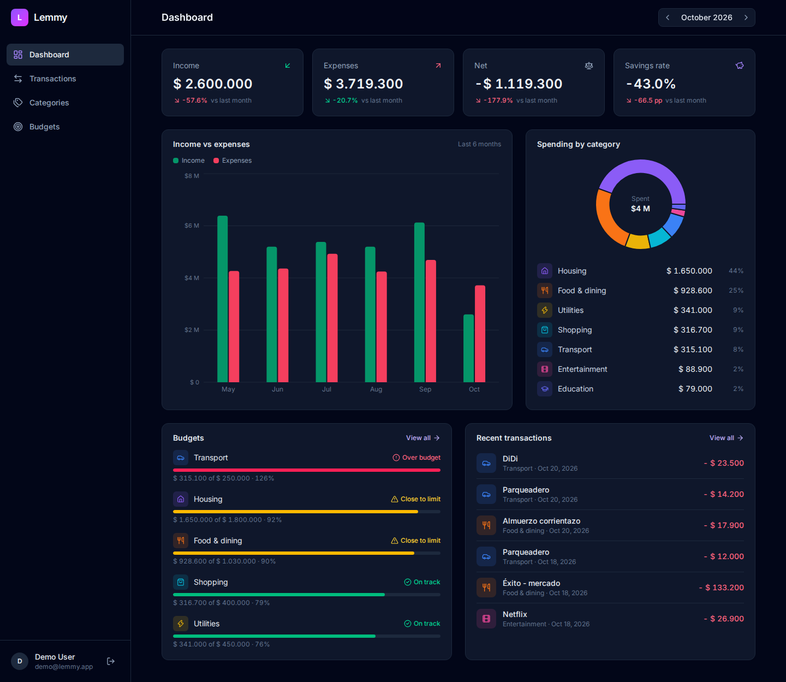
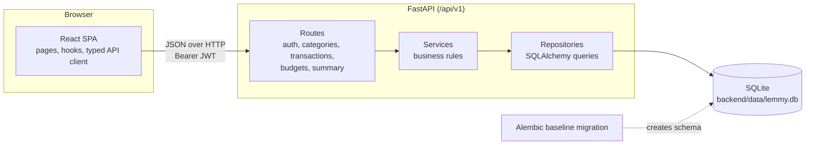
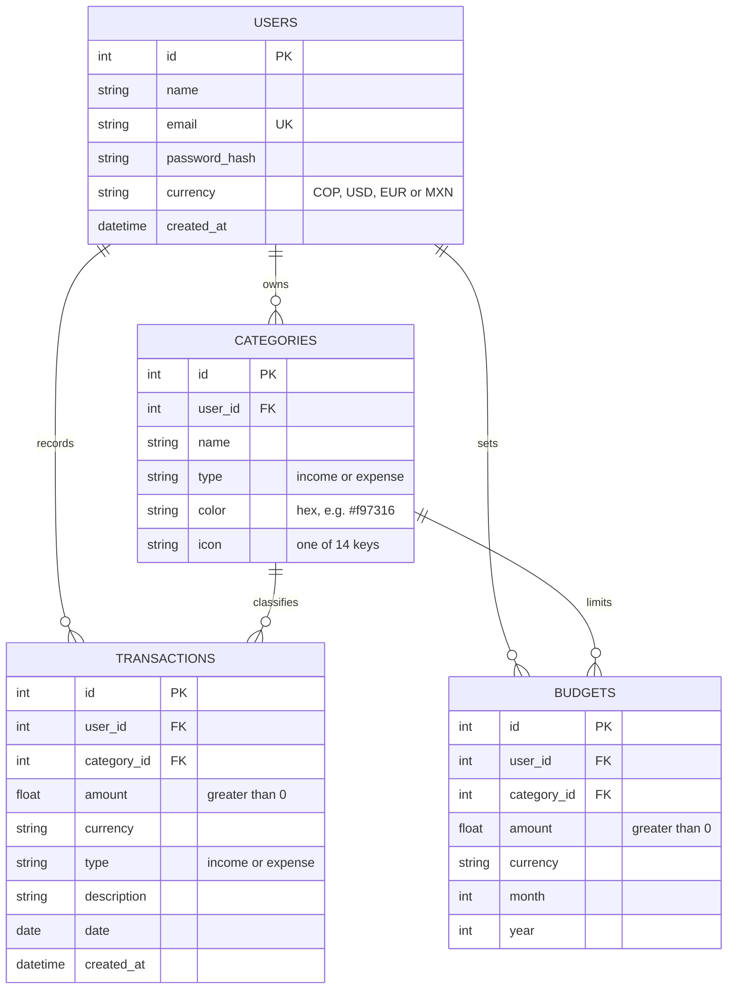
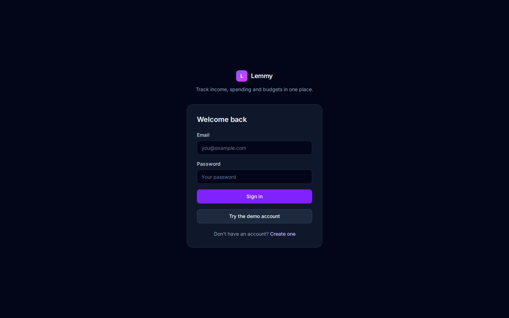
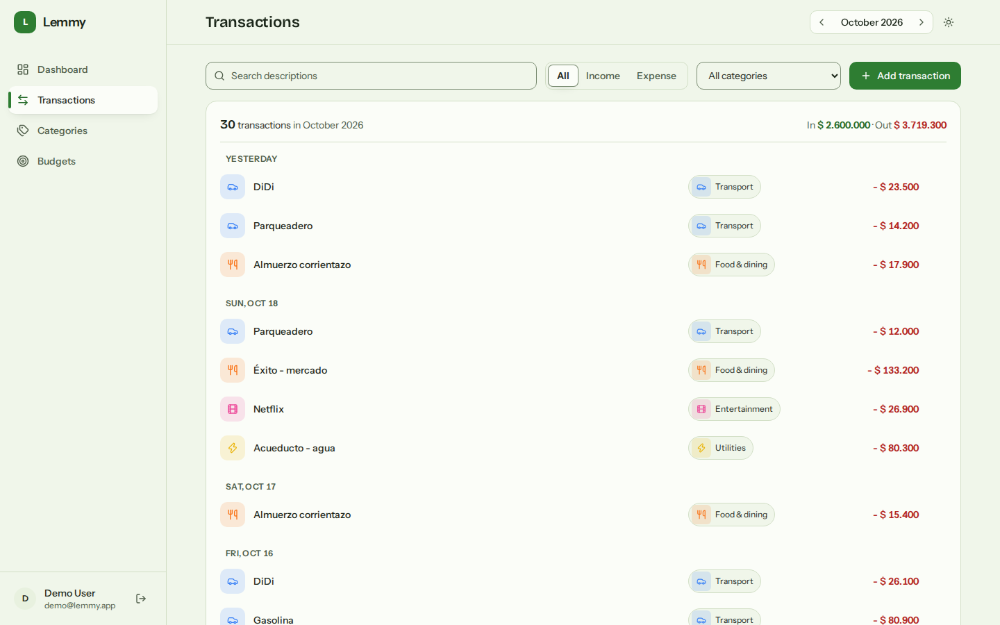
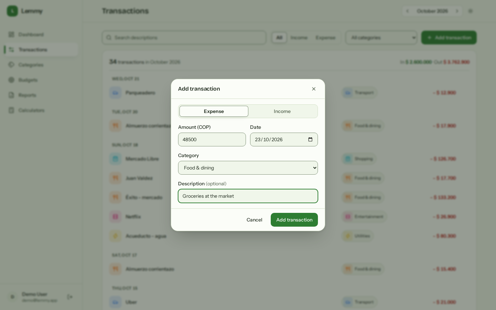
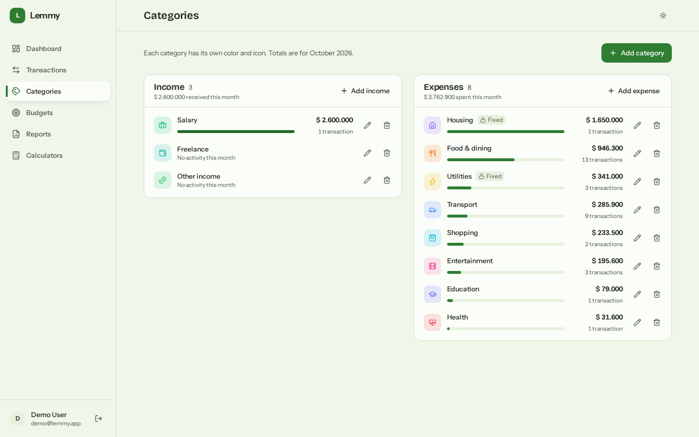
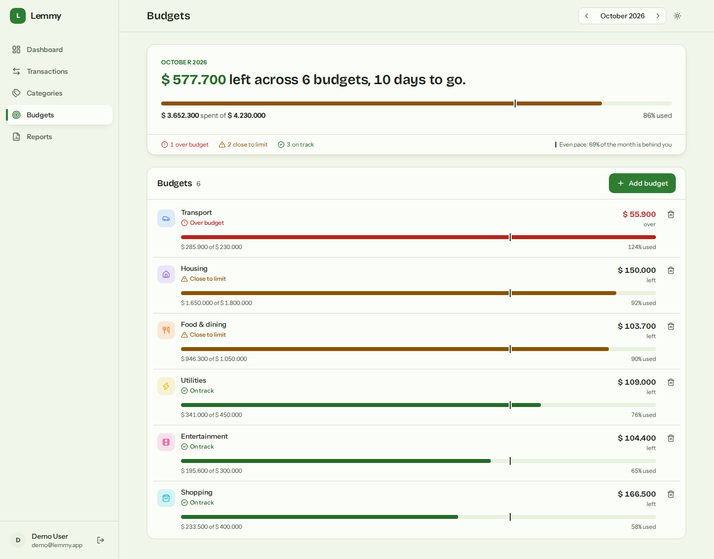
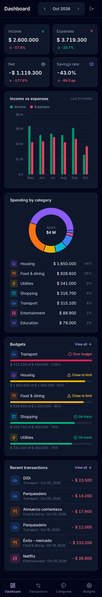

# Lemmy

**A personal finance tracker that tells you where your money went this month, and whether you're still on budget.**

Lemmy records income and expenses by category, sets monthly budgets per category, and turns them into a dashboard: month-over-month KPIs, a six-month income vs expenses trend, spending by category and budget health. It's a full-stack project built to be easy to run: one command starts the API and the web app against a local SQLite file, already seeded with six months of realistic demo data.



## Features

- **Dashboard**: income, expenses, net and savings rate with change vs last month; six-month income vs expenses chart; spending-by-category donut with a table-style legend; the five budgets closest to their limit; recent transactions.
- **Transactions**: filter by type, category and description search (debounced), all kept in the URL; server-side pagination; add, edit and delete with the backend's validation messages shown in the form.
- **Categories**: income and expense groups, each category with one of 10 colors and 14 icons; 11 sensible defaults created on sign-up.
- **Budgets**: monthly limit per expense category with spent, remaining, percent used and a status (on track, close to limit, over budget) shown with an icon and a label, never color alone.
- **Month navigation**: the selected month lives in `?month=YYYY-MM`, so every view can be bookmarked and shared.
- **Responsive**: sidebar on desktop, bottom navigation on phones, and touch targets of at least 44 px on small screens.
- **Demo account**: `demo@lemmy.app` / `demo1234`, one click from the login page.

## Tech stack

| Layer | Tools |
|---|---|
| Backend | Python, FastAPI, SQLAlchemy 2, Alembic, Pydantic 2, JWT (python-jose) with bcrypt password hashing |
| Database | SQLite (single file, foreign keys enforced) |
| Frontend | React 19, TypeScript, Vite, Tailwind CSS 4, React Router 7, Recharts, lucide-react icons, sonner toasts, axios |
| Tests | pytest + httpx (API), Vitest + Testing Library (frontend) |
| Tooling | npm scripts with `concurrently`, ESLint, optional Docker Compose |

## Architecture



The backend is layered so each piece has one job:

- **Routes** parse and validate the request (Pydantic schemas) and pick the current user from the JWT.
- **Services** hold the business rules: type and category must match, a category can't be deleted while it's in use, budgets only on expense categories, and so on.
- **Repositories** are the only code that talks to SQLAlchemy. Summary queries aggregate in SQL (`SUM`, `COUNT`, `GROUP BY` over half-open date ranges) instead of loading rows into Python.

The frontend keeps the same separation: `api/` holds one typed module per resource, `hooks/` holds data fetching and URL state, and `pages/` composes small components from `components/`.

### Data model



Budgets are unique per `(user_id, category_id, month, year)`, and transactions have an index on `(user_id, date)` for the monthly queries.

## Quickstart

You need **Python 3.12+** and **Node.js 22+**.

```bash
git clone https://github.com/Rerzd/Lemmy.git
cd Lemmy

# A virtual environment puts `python` on your PATH for the npm scripts.
python3 -m venv backend/.venv
source backend/.venv/bin/activate        # Windows: backend\.venv\Scripts\activate

npm run setup    # installs both apps, creates the database and seeds the demo user
npm run dev      # API on http://localhost:8000, web app on http://localhost:5173
```

Open http://localhost:5173 and click **Try the demo account**. Interactive API docs are at http://localhost:8000/docs.

No `.env` is needed: every setting has a working development default. To change one, copy `backend/.env.example` to `backend/.env` (or `frontend/.env.example` to `frontend/.env` for the API URL).

| Script | What it does |
|---|---|
| `npm run setup` | Install root, frontend and backend dependencies, migrate and seed |
| `npm run dev` | Run API and web app together, with reload |
| `npm run db:migrate` | `alembic upgrade head` |
| `npm run db:seed` | Create or reset the demo user and its data |
| `npm run db:reset` | Delete the database file, migrate and seed again |
| `npm test` | Backend tests, then frontend tests |

### With Docker (optional)

```bash
docker compose up --build
docker compose exec backend python -m app.scripts.seed_demo   # optional demo data
```

The app is served on http://localhost:8080 and the API on http://localhost:8000. The backend image runs as a non-root user and applies migrations on start; the database lives in the `lemmy-data` volume. Set `SECRET_KEY` in your shell before running it anywhere but your own machine.

## API overview

All endpoints are under `/api/v1`. Everything except register and login needs an `Authorization: Bearer <token>` header, and every query is scoped to the current user.

| Method | Path | Description |
|---|---|---|
| POST | `/auth/register` | Create an account (also creates the 11 default categories) |
| POST | `/auth/login` | Form fields `username` (email) and `password`; returns a JWT valid for 24 h |
| GET | `/auth/me` | Current user |
| GET, POST | `/categories` | List or create categories |
| GET, PUT, DELETE | `/categories/{id}` | Read, update or delete a category |
| GET | `/transactions` | Filters: `month`, `year`, `type`, `category_id`, `q`, `date_from`, `date_to`; paging with `limit` (max 500) and `offset`. The total is in the `X-Total-Count` header |
| POST | `/transactions` | Create a transaction |
| GET, PUT, DELETE | `/transactions/{id}` | Read, update or delete a transaction |
| GET, POST | `/budgets` | List budgets (optionally filtered by `month` and `year`) or create one |
| GET | `/budgets/status` | Each budget for a month with spent, remaining, percent used and status |
| GET, PUT, DELETE | `/budgets/{id}` | Read, update the amount of, or delete a budget |
| GET | `/summary/overview` | Income, expenses, net, savings rate and change vs the previous month |
| GET | `/summary/by-category` | Totals and share per category for a month (`type`, default `expense`) |
| GET | `/summary/trend` | Income, expenses and net for the last `months` months (1 to 24, default 6), including empty months |

`month` and `year` default to the current month on the `/summary/*` endpoints and `/budgets/status`.

## Business rules

The API enforces these, and the frontend shows its messages as they come back:

- **Amounts are positive.** Whether money comes in or goes out is the transaction's `type`, never the sign. Zero or negative amounts are a `422`.
- **Type must match the category.** An expense can't be filed under an income category (`422`).
- **One currency per account.** Transactions and budgets use the account's currency; sending a different one is a `422` ("Multi-currency is not supported yet").
- **Budgets only on expense categories**, and only one per category per month (`409` on a duplicate).
- **No cascading deletes.** A category with transactions or budgets can't be deleted; the `409` says how many it has. Changing the type of a category that has transactions is also a `409`.
- **Budget status:** under 80 % used is *on track*, 80 to 100 % is *close to limit*, over 100 % is *over budget*.
- **Percent changes** compare against the previous month and divide by its absolute value, so a net going from -100 to -50 counts as an improvement. When the previous value is zero the change is `null` rather than infinity.
- **Savings rate** is net divided by income, and `null` in a month without income.

## Local database

Lemmy uses a single SQLite file on purpose: there's no database server to install, and the whole state is one file you can delete.

- **Location:** `backend/data/lemmy.db`, created on the first migration. The `backend/data/` folder is ignored by git. The path is resolved relative to `backend/`, so it's the same file whichever directory you start the API from.
- **Schema:** a single Alembic baseline migration (`backend/alembic/versions/0001_baseline.py`) creates everything. Migrations run in batch mode so later `ALTER`s also work on SQLite.
- **Integrity:** every connection runs `PRAGMA foreign_keys=ON`, so foreign keys are actually enforced.
- **Reset:** `npm run db:reset` deletes the file and rebuilds it with fresh demo data. The demo data is generated relative to today, so the dashboard always has the last six months filled in.
- **Inspect:** `sqlite3 backend/data/lemmy.db ".tables"`, or open the file in any SQLite browser.

`DATABASE_URL` can point elsewhere, but SQLite is the only database this project is tested against.

## Testing

| Suite | Tests | Covers |
|---|---|---|
| Backend (pytest + httpx) | **29** | Auth, business rules (amounts, type/category match, currency, budget uniqueness, protected deletes), transaction filters and pagination, default categories, summary math, the demo seed |
| Frontend (Vitest + Testing Library) | **37** | Month math and the `?month` URL param, money formatting, API error messages, palette and status helpers, the `useMonth` hook, progress bar, pagination and segmented control |

```bash
npm test             # both suites
npm run test:api     # backend only (in-memory SQLite, no setup needed)
npm run test:web     # frontend only
```

`npm --prefix frontend run lint` and `npm --prefix frontend run build` should also pass cleanly.

## Project structure

```
.
├── backend/
│   ├── alembic/versions/0001_baseline.py   # the single schema migration
│   ├── app/
│   │   ├── api/v1/routes/      # auth, categories, transactions, budgets, summary
│   │   ├── core/               # settings, database engine, security, default categories
│   │   ├── models/             # SQLAlchemy models
│   │   ├── repositories/       # all database queries
│   │   ├── schemas/            # Pydantic request and response models
│   │   ├── services/           # business rules
│   │   ├── scripts/seed_demo.py
│   │   └── main.py
│   ├── tests/
│   └── Dockerfile
├── frontend/
│   ├── src/
│   │   ├── api/                # typed client, one module per resource
│   │   ├── components/         # ui/, layout/, dashboard/, transactions/, categories/, budgets/
│   │   ├── context/            # auth provider
│   │   ├── hooks/              # useAsync, useMonth, useAuth
│   │   ├── lib/                # money, dates, errors, colors, status helpers
│   │   ├── pages/              # Dashboard, Transactions, Categories, Budgets, Auth
│   │   └── types/api.ts        # mirrors the backend schemas
│   ├── Dockerfile
│   └── nginx.conf
├── docs/screenshots/
├── docker-compose.yml
└── package.json                # one-command scripts for the whole project
```

## Screenshots

| | |
|---|---|
|  |  |
| Login with one-click demo access | Transactions with filters and pagination |
|  |  |
| Adding a transaction | Categories with colors and icons |
|  |  |
| Budgets with status per category | Dashboard on a 375 px phone |

## Roadmap

- **Forecasting:** project next month's spending per category from history (for example with Prophet).
- **Multi-currency:** per-transaction currencies with exchange rates, instead of one currency per account.
- **Exact amounts:** store money as `Numeric` instead of `Float` to rule out rounding drift.
- **Recurring transactions:** rent, salary and subscriptions created automatically each month.
- **CSV import:** bring in bank statements and map their columns to categories.
